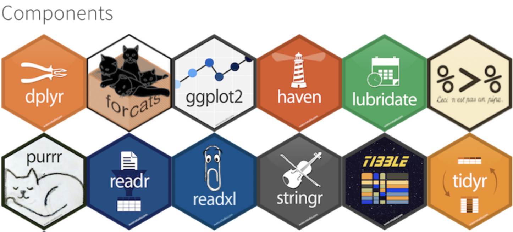

# Tidyverse overview

## What is tidyverse?

R packages allow you to use additional functions that are not pre-programmed as part of base R.

The tidyverse package is a package of packages that allows users to load in common packages quickly, rather than one at a time.

*Source: [Tidyverse data wrangling](https://hbctraining.github.io/Intro-to-R/lessons/tidyverse_data_wrangling.html)*

The tidyverse is a toolkit for the everyday tasks of working with data. Each package that comes with tidyverse is a set of tools:

- **readr**: reading data into R
- **dplyr**: choosing rows and columns, creating new variables, and summarising
- **tidyr**: reshaping data 
- **forcats**: working with categorical variables
- **stringr**: working with text
- **lubridate**: working with dates and times
- **ggplot2**: making plots

In this workshop we will mostly use **readr**, **dplyr**, **tidyr** and **forcats**. Future workshops will focus on visulization with ggplot. 

### Resources and related workshops

There are many free resources for tidyverse! Posit provides one-page [cheat sheets](https://posit.co/resources/cheatsheets/){:target="_blank"} for most tidyverse packages.

There are other UBC Library workshops that might be of interest and are related to this one:

- [Relational data in R](https://ubc-library-rc.github.io/relational-data-r/)
- [Data manipulation with dplyr](https://ubc-library-rc.github.io/data-manipulation-dplyr/)
- [Data visualization with ggplot2](https://ubc-library-rc.github.io/ggplot2_intro_workshop/)
